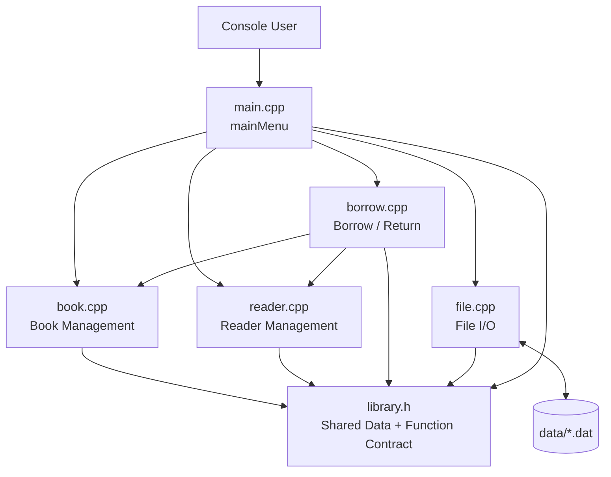
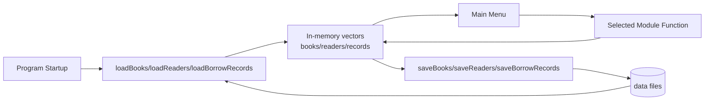
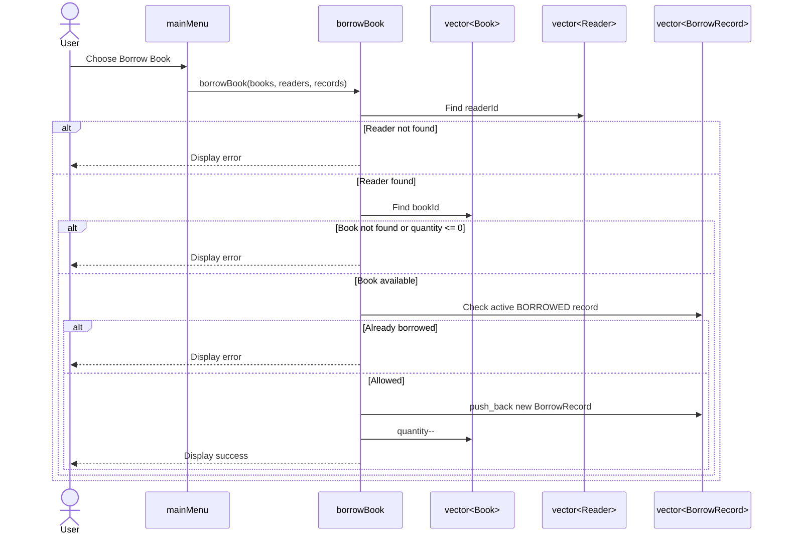
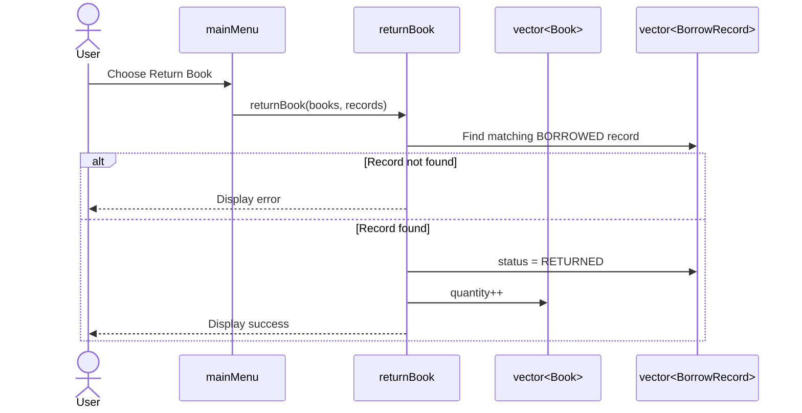

# Architecture & Codebase Research

Date: 2026-10-12

Scope: static exploration of the current C++ source code, module contract, verification script, and performance/technical-debt risks.

## 1. Repository Snapshot

Current source files:

| Area | Files | Status |
| --- | --- | --- |
| Shared contract | `library.h` | Defines all data structures and public function signatures |
| Book module | `book.cpp` | Present, currently empty |
| Reader module | `reader.cpp` | Present, currently empty |
| Borrow / Return module | `borrow.cpp` | Present, currently empty |
| File I/O module | `file.cpp` | Present, currently empty |
| UI / Integration | `main.cpp` | Present, currently empty |
| Verification | `scripts/verify.sh` | Active deterministic syntax/header compile check |
| Data fixtures | `data/*.dat` | Present, currently empty |

The application implementation has not started yet: `main.cpp`, `book.cpp`, `reader.cpp`, `borrow.cpp`, and `file.cpp` are 0-byte files. Therefore, the bottleneck analysis below separates confirmed architecture facts from implementation risks.

## 2. Confirmed Data Model

`library.h` is the current source-of-truth contract. It uses `std::vector` and `std::string` as the core collection/text model (`library.h:4-5`), and places the C++ standard library into global scope with `using namespace std` (`library.h:7`).

```cpp
struct Book {
    int id;
    string title;
    string author;
    int quantity;
};
```

Evidence: `Book` is defined in `library.h:12-17`, `Reader` in `library.h:20-24`, and `BorrowRecord` in `library.h:26-30`.

Borrow status is represented by integer constants:

```cpp
const int BORROWED = 1;
const int RETURNED = 0;
```

Evidence: `library.h:9-10`.

## 3. Module Contract

The current architecture is function-module based rather than class/OOP based.

| Module | Contract Evidence |
| --- | --- |
| Book Management | `addBook`, `updateBook`, `deleteBook`, `searchBook`, `displayBooks`, `sortBooks` in `library.h:37-47` |
| Reader Management | `addReader`, `updateReader`, `deleteReader`, `searchReader`, `displayReaders` in `library.h:53-61` |
| Borrow / Return | `borrowBook`, `returnBook` in `library.h:67-76` |
| File I/O | `saveBooks`, `loadBooks`, `saveReaders`, `loadReaders`, `saveBorrowRecords`, `loadBorrowRecords` in `library.h:82-96` |
| Menu / Integration | `bookMenu`, `readerMenu`, `mainMenu` in `library.h:102-110` |

## 4. System Layout



## 5. Primary Data Flow



## 6. Borrow Book Sequence



## 7. Return Book Sequence



## 8. Bottleneck & Technical Debt Audit

### P1 - Linear Search Will Become the Main Runtime Cost

The contract stores entities in `vector<Book>`, `vector<Reader>`, and `vector<BorrowRecord>` by passing vectors through module functions (`library.h:37-47`, `library.h:53-61`, `library.h:67-76`). If implemented with simple loops, ID lookup, duplicate checks, borrow validation, search, and return lookup will be O(n). This is acceptable for a course-scale console project, but it is the clearest future performance bottleneck.

Recommendation:
- For the current assignment, keep vector loops because they are easy to explain.
- If data grows, introduce helper functions such as `findBookIndexById`, `findReaderIndexById`, and `findBorrowRecordIndex`, then consider `unordered_map<int, size_t>` indexes only after the vector version is stable.

### P2 - Borrow / Return Depends on Cross-Vector Consistency

`borrowBook` receives books, readers, and records together (`library.h:67-71`), while `returnBook` receives books and records (`library.h:73-76`). This makes the borrow module the main consistency boundary. Bugs here can create mismatches such as a returned record without restoring quantity or duplicate active borrow records.

Recommendation:
- Centralize checks for active borrow records inside `borrow.cpp`.
- Cover duplicate borrow, return twice, unavailable quantity, and missing book/reader in the manual test-case table before final reporting.

### P3 - File I/O Can Become a User-Visible Latency Point

The contract has whole-collection save/load functions for books, readers, and borrow records (`library.h:82-96`). If every menu operation saves all vectors synchronously, console actions may become slower as data grows. With small course data this is fine; the risk appears if save is called too often.

Recommendation:
- Load once at startup.
- Save explicitly through "Save Data" and on exit.
- Avoid saving after every single keystroke or every display/search operation.

### P4 - No Build Manifest Yet

There is no `Makefile`, `CMakeLists.txt`, or IDE project file in the repository scan. The active build contract is currently embedded in `scripts/verify.sh`, which selects `c++` or `CXX` (`scripts/verify.sh:16-17`) and checks the known source files (`scripts/verify.sh:19-22`).

Recommendation:
- Keep `scripts/verify.sh` as the canonical command.
- Add a small `Makefile` later if the group wants a friendlier manual build command, but keep it called by `verify.sh` rather than replacing the verification entrypoint.

### P5 - Current Verification Does Not Link the Full Application

`scripts/verify.sh` checks each source file with `-fsyntax-only` (`scripts/verify.sh:38-41`) and builds a header compile check (`scripts/verify.sh:43-67`). This is enough while module files are empty, but it will not catch missing function definitions or link errors after implementation starts.

Recommendation:
- After the first real function implementations, extend `verify.sh` to compile and link the full application or a focused test binary.
- Keep manual module test cases as the required course evidence; automated tests are optional if the team has time.

### P6 - Header Pollutes Global Namespace

`library.h` uses `using namespace std` at global header scope (`library.h:7`). This is not a performance bottleneck, but it is a maintainability risk because every file that includes the header inherits the entire `std` namespace.

Recommendation:
- For a small course project, this can remain if the team prioritizes beginner readability.
- For cleaner C++ style, replace it with explicit `std::vector` and `std::string` in a later coordinated contract update.

### P7 - Status Uses Raw Integers

Borrow status uses `const int BORROWED = 1` and `const int RETURNED = 0` (`library.h:9-10`), and `BorrowRecord.status` is an `int` (`library.h:26-30`). This is simple, but it allows invalid states such as `status = 2`.

Recommendation:
- Keep constants for now because they are easy to explain.
- Add validation when loading records from file.
- If the course allows, upgrade later to `enum class BorrowStatus`.

## 9. Security & Privacy Boundary Notes

No application logging or credential handling exists yet because implementation files are empty. Current privacy/security risks are therefore design-time risks:

- File I/O should reject malformed records rather than silently creating invalid state.
- Menu input should validate numeric IDs and quantities before mutating vectors.
- Verification should remain deterministic and fail closed, following `scripts/verify.sh`'s current `set -euo pipefail` and `fail()` pattern (`scripts/verify.sh:1-7`).

## 10. Prioritized Action Plan

1. Implement Book Management first in a readable student-project style.
2. Run and record the Book Management manual test cases: duplicate ID, invalid quantity, search, display, and sort.
3. Implement Reader Management with matching validation style.
4. Implement Borrow / Return and record cross-vector consistency test cases.
5. Implement File I/O, including malformed input handling where practical.
6. Integrate menus after individual modules behave correctly.
7. Run `./scripts/verify.sh` before each milestone and before final submission.

## 11. Summary

The current codebase is a clean contract-first skeleton. The architecture is appropriate for a course project: flat C++ modules, shared `library.h`, in-memory vectors, and file persistence. The main future performance bottleneck is predictable O(n) vector scanning for lookup-heavy workflows, but that trade-off is acceptable at this stage and easier for the group to implement, test, and explain.
