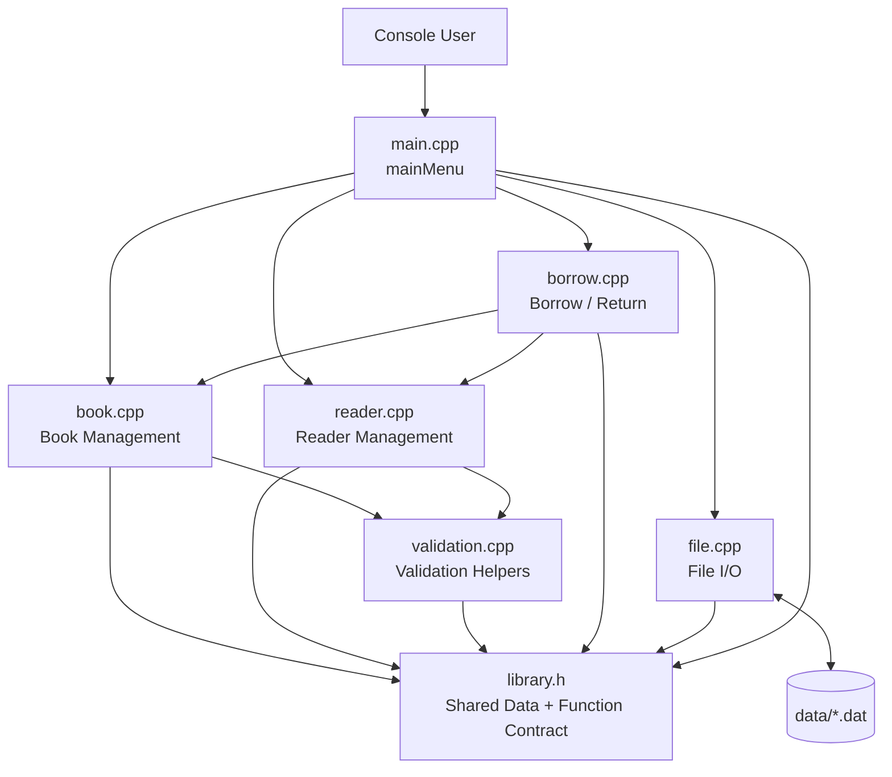
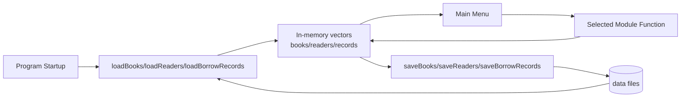
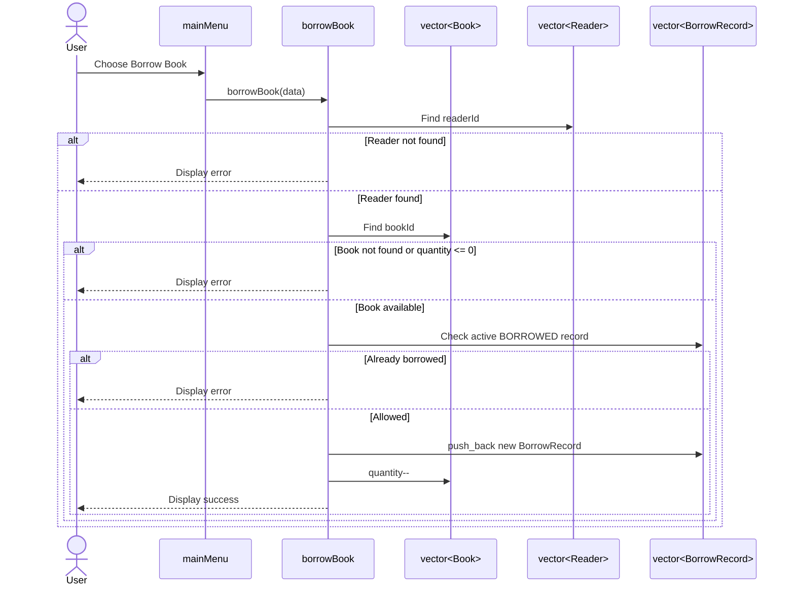
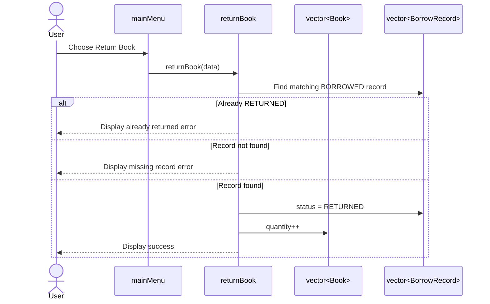

# Architecture & Codebase Research

Date: 2026-10-12

Scope: static exploration of the current C++ source code, module contract, verification script, and performance/technical-debt risks.

## 1. Repository Snapshot

Current source files:

| Area | Files | Status |
| --- | --- | --- |
| Shared contract | `library.h` | Defines all data structures and public function signatures |
| Validation helpers | `validation.cpp` | Implements reusable `isPositiveId`, `isNonNegativeNumber`, and `isEmptyText` helpers |
| Book module | `book.cpp` | Implemented for Sprint 2.0: add, update, delete, search, display, sort, `getBookById`, and `printBook` |
| Reader module | `reader.cpp` | Implemented for Sprint 3.0: add, update, delete, search, display, `getReaderById`, and `printReader` |
| Borrow / Return module | `borrow.cpp` | Implemented for Sprint 4.0: borrow flow, return flow, validation, active-borrow checks, and test-result recording |
| File I/O module | `file.cpp` | Present, pending Sprint 5.0 implementation |
| UI / Integration | `main.cpp` | Present, pending Sprint 6.0 implementation |
| Verification | `scripts/verify.sh` | Active deterministic syntax/header checks, architecture freshness checks, Book Management, Reader Management, and Borrow Management automated checks |
| Data fixtures | `data/*.dat` | Present, currently empty |

Sprint 2.0 has completed Book Management in `book.cpp`. Sprint 3.0 has
completed Reader Management in `reader.cpp`, including add, update, delete,
search, display, `getReaderById`, and `printReader`. Sprint 4.0 has completed
Borrow / Return in `borrow.cpp`, including valid borrow, missing reader/book,
unavailable book, duplicate active borrow, valid return, missing return record,
and already-returned validation. The shared `validation.cpp` helper module owns
simple ID, non-negative number, and empty-text checks. `main.cpp` and `file.cpp`
are still pending, so the bottleneck analysis below separates confirmed
implemented behavior from future module risks.

## 2. Confirmed Data Model

`library.h` is the current source-of-truth contract. It uses `std::vector` and `std::string` as the core collection/text model, and places the C++ standard library into global scope with `using namespace std`.

```cpp
struct Book {
    int id;
    string title;
    string author;
    int quantity;
};
```

Evidence: `Book`, `Reader`, and `BorrowRecord` are defined in the Data Structures section of `library.h`.

Cross-list workflows use a small aggregate struct:

```cpp
struct LibraryData {
    vector<Book> books;
    vector<Reader> readers;
    vector<BorrowRecord> borrowRecords;
};
```

Evidence: `LibraryData` is defined in `library.h` and is used by Borrow /
Return functions that need coordinated access to books, readers, and records.

Borrow status is represented by integer constants:

```cpp
const int BORROWED = 1;
const int RETURNED = 0;
```

Evidence: `BORROWED` and `RETURNED` are defined near the top of `library.h`.

## 3. Module Contract

The current architecture is function-module based rather than class/OOP based.

| Module | Contract Evidence |
| --- | --- |
| Validation Helpers | `isPositiveId`, `isNonNegativeNumber`, `isEmptyText` in the Validation Helpers section of `library.h` |
| Book Management | `getBookById`, `printBook`, `addBook`, `updateBook`, `deleteBook`, `searchBook`, `displayBooks`, `sortBooks` in the Book Management section of `library.h` |
| Reader Management | `getReaderById`, `printReader`, `addReader`, `updateReader`, `deleteReader`, `searchReader`, `displayReaders` in the Reader Management section of `library.h` |
| Borrow / Return | `borrowBook`, `returnBook` in the Borrow / Return section of `library.h` |
| File I/O | `saveBooks`, `loadBooks`, `saveReaders`, `loadReaders`, `saveBorrowRecords`, `loadBorrowRecords` in the File I/O section of `library.h` |
| Menu / Integration | `bookMenu`, `readerMenu`, `mainMenu` in the Menu section of `library.h` |

## 4. System Layout



## 5. Primary Data Flow



## 6. Borrow Book Sequence



## 7. Return Book Sequence



## 8. Bottleneck & Technical Debt Audit

### P1 - Linear Search Will Become the Main Runtime Cost

The contract stores entities in `vector<Book>`, `vector<Reader>`, and `vector<BorrowRecord>` by passing vectors through module functions declared in `library.h`. If implemented with simple loops, ID lookup, duplicate checks, borrow validation, search, and return lookup will be O(n). This is acceptable for a course-scale console project, but it is the clearest future performance bottleneck.

Recommendation:
- For the current assignment, keep vector loops because they are easy to explain.
- If data grows, introduce helper functions such as `findBookIndexById`, `findReaderIndexById`, and `findBorrowRecordIndex`, then consider `unordered_map<int, size_t>` indexes only after the vector version is stable.

### P2 - Borrow / Return Depends on LibraryData Consistency

`borrowBook` and `returnBook` receive `LibraryData&`, which groups books,
readers, and borrow records for cross-list workflows. This keeps function
signatures short, but it also makes the borrow module the main consistency
boundary. Bugs here can create mismatches such as a returned record without
restoring quantity or duplicate active borrow records.

Recommendation:
- Centralize checks for active borrow records inside `borrow.cpp`.
- Keep duplicate borrow, return twice, unavailable quantity, and missing
  book/reader covered in the manual test-case table and automated module check.

### P3 - File I/O Can Become a User-Visible Latency Point

The contract has whole-collection save/load functions for books, readers, and borrow records. If every menu operation saves all vectors synchronously, console actions may become slower as data grows. With small course data this is fine; the risk appears if save is called too often.

Recommendation:
- Load once at startup.
- Save explicitly through "Save Data" and on exit.
- Avoid saving after every single keystroke or every display/search operation.

### P4 - No Build Manifest Yet

There is no `Makefile`, `CMakeLists.txt`, or IDE project file in the repository scan. The active build contract is currently embedded in `scripts/verify.sh`, which selects `c++` or `CXX` (`scripts/verify.sh:16-17`) and checks the known source files (`scripts/verify.sh:19-22`).

Recommendation:
- Keep `scripts/verify.sh` as the canonical command.
- Add a small `Makefile` later if the group wants a friendlier manual build command, but keep it called by `verify.sh` rather than replacing the verification entrypoint.

### P5 - Current Verification Links Focused Module Checks, Not the Full Application

`scripts/verify.sh` checks each source file with `-fsyntax-only`, builds a
header compile check, checks documentation freshness for known architecture
drift, and builds/runs the Book Management, Reader Management, and Borrow
Management automated regression checks. This catches module link errors, but it
still does not link the future full application because `main.cpp` and
`file.cpp` are not implemented yet.

Recommendation:
- Keep adding focused module regression checks as each module is implemented.
- After menu integration, extend `verify.sh` to compile and link the full application.
- Keep manual module test cases as the required course evidence; automated tests are optional if the team has time.

### P6 - Header Pollutes Global Namespace

`library.h` uses `using namespace std` at global header scope. This is not a performance bottleneck, but it is a maintainability risk because every file that includes the header inherits the entire `std` namespace.

Recommendation:
- For a small course project, this can remain if the team prioritizes beginner readability.
- For cleaner C++ style, replace it with explicit `std::vector` and `std::string` in a later coordinated contract update.

### P7 - Status Uses Raw Integers

Borrow status uses `const int BORROWED = 1` and `const int RETURNED = 0`, and `BorrowRecord.status` is an `int`. This is simple, but it allows invalid states such as `status = 2`.

Recommendation:
- Keep constants for now because they are easy to explain.
- Add validation when loading records from file.
- If the course allows, upgrade later to `enum class BorrowStatus`.

## 9. Security & Privacy Boundary Notes

No application logging or credential handling exists. Current privacy/security risks are therefore design-time risks for the remaining modules:

- File I/O should reject malformed records rather than silently creating invalid state.
- Menu input should validate numeric IDs and quantities before mutating vectors.
- Verification should remain deterministic and fail closed, following `scripts/verify.sh`'s current `set -euo pipefail` and `fail()` pattern (`scripts/verify.sh:1-7`).

## 10. Prioritized Action Plan

1. Use the completed Book Management module as the style reference for future modules.
2. Implement Reader Management with matching validation style.
3. Keep Borrow / Return regression checks green while moving to File I/O.
4. Implement File I/O, including malformed input handling where practical.
5. Integrate menus after individual modules behave correctly.
6. Run `./scripts/verify.sh` before each milestone and before final submission.

## 11. Summary

The current codebase is a contract-first C++ course project with Book
Management, Reader Management, and Borrow / Return implemented. The architecture
remains appropriate for the assignment: flat C++ modules, shared `library.h`,
in-memory vectors, focused automated checks, manual E2E evidence, and file
persistence planned for the next sprint. The main future performance bottleneck
is predictable O(n) vector scanning for lookup-heavy workflows, but that
trade-off is acceptable at this stage and easier for the group to implement,
test, and explain.
